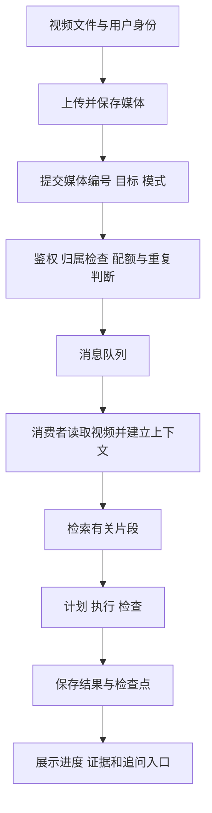

# 01 一次视频分析怎样经过整个后端

上一章认识了请求、存储和模型。现在把它们连接起来。假设用户编号为 7，上传的视频最终得到媒体编号 42。这些编号只是教学示例，你本地得到的编号可能不同。

用户目标始终是“整理前序遍历步骤，并给出视频证据”。后端需要完成两项相互关联的工作：先让视频可靠地进入系统，再围绕这个视频运行分析任务。

## 1 第一条链路是接收视频

浏览器把大文件切成小块逐个发送。后端创建 `uploadId`，记录哪些分片到达，最后按顺序合并成文件并上传 MinIO。数据库保存媒体记录，得到 `mediaId=42`。

这里的输出只是“系统现在有一条可访问的视频记录”。还没有必然得到转写、证据或学习笔记。上传和分析分开，用户才能管理文件，并对同一视频提出不同目标。

## 2 第二条链路是完成分析

用户选择学习模式并提交目标。后端先检查登录身份和视频归属，再检查是否已有同目标、同模式的结果。若需要新分析，系统受理并投递消息，消费者随后处理。

从受理到完成可能需要较长时间，所以请求返回“已受理”与业务状态“已完成”必须区分。页面的进度来自后端阶段事件与查询，不是前端随便播放的动画。

## 3 后端的类分别承担什么

把餐厅类比为软件系统：Controller 像接单窗口，Service 像协调业务的负责人，Mapper 和 Repository 负责账本读写。但真正判断职责时，要看代码输入和输出，而不只看名字。

`AnalysisController` 负责接收接口参数、取得用户身份，调用业务能力并返回 HTTP 响应。`AnalysisDispatchService` 负责提交规则、限流和投递。`VideoAnalysisConsumer` 负责消息消费链路。`AgentLoopService` 则负责模型分析中的循环。

这些步骤属于一个后端工程中的不同职责，不表示已经拆成多个微服务。初学时先追踪一个进程内的调用，再理解消息造成的异步边界。

## 4 为什么需要多种存储

MySQL 保存用户、媒体、检查点和完成凭据等结构化数据；MinIO 保存大文件；Redis 提供快速临时状态和协调能力；RocketMQ 把生产任务与消费任务解耦；Qdrant 辅助按语义寻找相关内容。

例如视频文件上传成功但媒体记录没提交，会形成文件与业务记录不一致的问题；队列收到任务但模型超时，会形成任务恢复问题。用了多个组件之后，每个组件自己的成功并不等于整个流程成功。

## 5 从接口开始追一次代码

打开 [AnalysisController](../../../server/src/main/java/com/example/server/controller/AnalysisController.java)，找到 `aiAnalyze`。先认出四个输入：`id`、`goal`、`mode`、认证后的 `userId`。

然后找到 `requireOwnedMetadata`，它检查你是否可以操作这条媒体。接着看 `loadResult`：如果已有可复用结果，可以直接按完成情况响应。最后追踪 `dispatchService.submit`，此处进入提交与排队。

这一遍不要打开所有工具类。用自己的话把这三个判断写出来，已经完成了对入口的第一层理解。

## 6 本章练习与答案

问：用户 7 对视频 42 提出两个不同目标，为什么不能只用 `mediaId` 识别结果？答：两个目标可能要求完全不同的产物，需要把目标和模式纳入任务隔离；视频身份和分析任务身份不同。

问：为什么 HTTP 请求成功后还可能分析失败？答：受理请求和异步执行发生在不同阶段，后续解码、模型服务或持久化仍可能失败。客户端需要继续查看任务状态。

下一章：[接口与认证](02-api-and-auth.md)。
