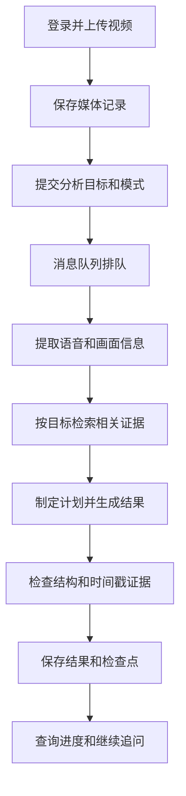

# 01 从一次视频分析认识 Agent 后端

假设你上传一段算法课视频，输入：“帮我整理二叉树的知识点，并指出我应该复习哪里。”后端需要先把视频变成资料，再让模型围绕你的目标工作，最后保存可继续追问的结果。

## 先认识三个词

**模型**负责理解文字并生成内容，可以理解为一个有语言能力的处理器。**工具**负责具体操作，例如提取音频、识别文字、查找片段。**Agent 编排**负责决定步骤、调用能力、检查结果和决定是否继续。

本项目的 Agent 使用预先设计的计划、执行、检查流程，并有明确的轮次和预算约束。它不表示模型能在服务器上任意执行操作，也不等于多个独立服务互相聊天。

## 完整链路

用户看到的是“分析一下视频”，后端实际处理的是一串有身份、有状态、会失败也能重试的步骤。

## 各个组件做什么

| 组件 | 通俗理解 | 本项目用途 |
| --- | --- | --- |
| Spring Boot | 接待和协调工作的服务 | 接收请求、执行业务规则 |
| MySQL | 长期账本 | 用户、媒体、检查点、失败记录及上传完成凭据 |
| Redis | 快速状态台 | 登录会话、缓存、锁、限流和部分临时状态 |
| MinIO | 文件仓库 | 视频、分片和证据图片等对象 |
| RocketMQ | 待办队列 | 将耗时分析交给消费者处理 |
| Qdrant | 按语义找资料的索引 | 辅助从长视频内容中找相关片段 |
| 模型服务 | 理解和生成内容的能力 | 模式判断、计划、分析等模型调用 |

## 第一次读代码

从 [AnalysisController](../../../server/src/main/java/com/example/server/controller/AnalysisController.java) 找到提交分析的接口，追到 `AnalysisDispatchService`，再找到消费者 `VideoAnalysisConsumer`。这一遍只记“谁调用谁”，不要求看懂所有细节。

自测：视频上传成功是否等于分析成功？答案是否定的，它们属于不同阶段。你应该能在图中指出两者的位置。

下一篇：[接口与认证](02-api-and-auth.md)。
