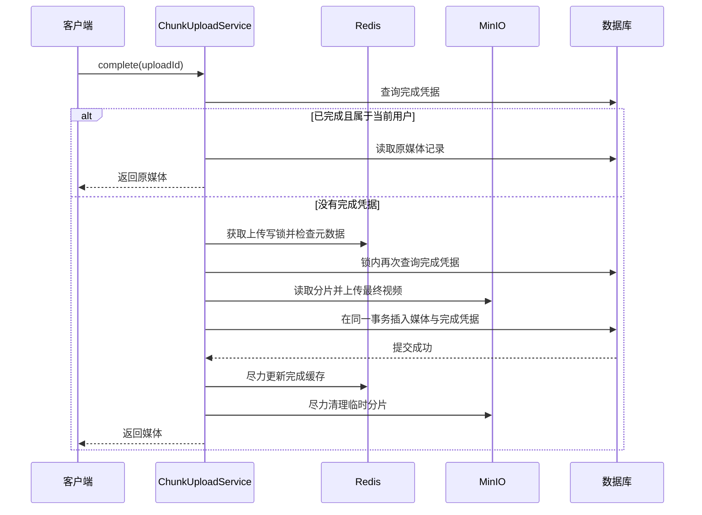

# 智能体后端学习笔记 分片上传的数据库幂等

视频智能体需要先得到一份稳定可用的视频记录，后续解析、检索、分析和检查点才能关联到正确的媒体。本篇从一次上传完成请求出发，学习重复请求、分布式锁、数据库事务和故障恢复之间的关系。

阅读目标：能够解释为什么已有 Redis 锁和完成缓存后仍可能产生重复记录，并沿着代码说明数据库兜底如何覆盖这个故障窗口。

## 阅读背景与实现来源

原项目已具备分片上传、Redis 上传状态、MinIO 分片存储、读写锁和完成请求重试处理。本仓库在这些能力上增加了数据库完成凭据及事务保护，代码变更见 [提交 3b20e54](https://github.com/2chaochan/DOVideo-AI-Next/commit/3b20e54)。原项目来源及许可见 [NOTICE](../../../NOTICE.md)。

本篇对应这次改造后的实现。工程部署和兼容细节见 [修改说明](../../development/upload-idempotency.md)。

## 一次上传有哪些身份和状态

| 名称 | 含义 | 在当前流程中的作用 |
| --- | --- | --- |
| `userId` | 已认证用户的身份 | 确认上传和媒体属于谁 |
| `uploadId` | 初始化上传时产生的 UUID | 识别同一次上传，作为幂等键 |
| `chunkIndex` | 从 0 开始的分片序号 | 标识上传中的某个分片 |
| `mediaId` | 数据库媒体记录的主键 | 供后续视频处理和分析使用 |
| 内容哈希 | 文件内容的摘要 | 参与后续内容识别，与上传身份分别管理 |

同一个视频重新初始化上传，会得到新的 `uploadId`。本次保障的是同一个 `uploadId` 的完成操作不会重复建档，不是限制相同文件只能上传一次。

“幂等”在这里指：针对同一次上传，多次执行完成请求，已提交的结果仍对应同一条媒体记录。请求次数、日志条数和临时对象上传次数不必相同；如果发生并发竞争，数据库必须防止多条媒体记录最终提交。

## 先沿入口阅读一次流程

从 [MediaController](../../../server/src/main/java/com/example/server/controller/MediaController.java) 找到下面的入口，再进入 [ChunkUploadService](../../../server/src/main/java/com/example/server/service/ChunkUploadService.java)。

| 接口 | 服务方法 | 主要职责 |
| --- | --- | --- |
| `POST /media/init-upload` | `initialize` | 检查文件名和分片总数，创建上传身份及 Redis 元数据 |
| `POST /media/upload-chunk` | `uploadChunk` | 检查归属、大小和序号，写入 MinIO 分片并记录已上传索引 |
| `GET /media/upload-status` | `uploadedChunks` | 查询已上传分片；有数据库完成凭据时返回全部索引 |
| `POST /media/complete-upload` | `complete` | 合并分片、上传最终对象、持久化媒体和完成凭据 |

当前单个分片最大 5 MiB，总分片数最多 410。未完成上传的元数据和分片索引仍在 Redis；完成凭据进入数据库后，完成重试可以摆脱这些临时状态。

## 原流程的故障窗口

原流程的关键顺序可以简化为：

```text
合并分片
  → 将最终视频上传 MinIO
  → 插入 media_files
  → 向 Redis 写入 uploadId 对应的完成凭据
  → 清理临时分片并返回
```

假设 `media_files` 已插入成功，服务恰好在写 Redis 前退出。数据库已经留下媒体记录，但重试请求只能看到“没有完成凭据”。如果分片和元数据仍在，后续请求就可能再次合并并插入媒体记录。

HTTP 请求失败只表明客户端没有拿到成功响应，不能证明服务端没有执行成功。设计重试时，需要考虑“已经提交，但确认消息没有到达”的情况。

### 为什么原来的锁仍有价值

服务使用同一个上传状态读写锁：上传分片持有读锁，合并持有写锁。这样合并不会读到正在替换中的分片，也能减少重复合并。

锁控制某个时间段内谁可以执行。进程退出、锁释放后，下一次请求仍需要判断前一次是否已经完成。这个判断需要持久化的业务证据，不能仅凭锁是否存在。

## 改造后的完成流程



代码还保留了升级前 Redis 完成凭据的读取分支。上图突出的是新上传的数据库路径；用户归属检查、异常处理和锁释放应同时对照源码阅读。

### 完成凭据表保存什么

[V4 数据库迁移](../../../server/src/main/resources/db/migration/V4__persist_chunk_upload_completions.sql) 新增 `chunk_upload_completions`：

| 字段 | 作用 |
| --- | --- |
| `upload_id` | 主键，从数据库层限制同一次上传只能有一条完成凭据 |
| `media_id` | 唯一索引，指向已经提交的媒体记录 |
| `user_id` | 完成凭据的归属用户 |
| `total_chunks` | Redis 元数据消失后，仍能返回完整的分片索引集合 |
| `created_at` | 完成记录的创建时间 |

表中没有设置删除媒体时级联删除凭据的外键。媒体删除后，凭据继续占住原上传身份；旧请求读取原媒体时得到不存在，而不是重新建立媒体。

### 为什么两次插入必须在一个事务里

[ChunkUploadRepository.save](../../../server/src/main/java/com/example/server/repository/ChunkUploadRepository.java) 的核心代码如下：

```java
@Transactional
public MediaFile save(String uploadId, int totalChunks, MediaFile media) {
  mediaMapper.insert(media);
  jdbc.update(
      "INSERT INTO chunk_upload_completions (upload_id, media_id, user_id, total_chunks) VALUES (?, ?, ?, ?)",
      uploadId,
      media.getId(),
      media.getUserId(),
      totalChunks);
  return media;
}
```

完整类及依赖注入见代码链接。这里的 MyBatis 和 JdbcTemplate 使用同一数据源，并参与同一个 Spring 管理的数据库事务。

如果只增加唯一约束，而媒体插入已经独立提交，那么凭据插入失败时，前面的媒体记录仍可能残留。把两步放在同一事务中后，唯一冲突抛出的运行时异常会触发回滚，失败一方的新增媒体记录也会撤销。

`ChunkUploadService` 通过注入的 Spring 仓储代理调用 `save`。事务方法正常返回到服务层时，两次写入已经提交。学习时要留意代理调用边界：在同一个对象内部直接调用自己的事务方法，不能直接套用这条代理调用结论。

### 并发情况下数据库如何兜底

设 A 和 B 都没有查到完成凭据，且因为异常情况都走到了持久化阶段：

1. A 和 B 分别在自己的事务中插入媒体记录。
2. 两个事务尝试插入相同的 `upload_id`。
3. 当其中一个事务成功提交后，另一方因唯一键冲突失败，并回滚自己的媒体插入。
4. 服务在事务外捕获 `DuplicateKeyException`，清理本次多余视频对象，再查询并返回已经提交的记录。

如果先占用唯一键的事务回滚，另一个事务可能成功。应验证最终只提交一份结果，而不是预设哪个请求必定获胜。自增主键发生跳号也不代表存在重复记录，应直接查询行数及完成凭据关联。

## Redis 和对象存储的职责边界

完成后重试、查询状态和迟到分片请求，先检查数据库完成凭据。只有未找到数据库凭据时，才继续使用旧凭据或未完成上传的 Redis 状态。

| 故障位置 | 当前行为 | 需要理解的原因 |
| --- | --- | --- |
| 数据库事务尚未提交时退出 | 未提交写入由数据库回滚；后续重试重新完成 | 媒体与凭据不能只提交其中一份 |
| 数据库已提交，但调用方未收到确认 | 重试查到原完成凭据，返回原媒体 | 业务结果可独立于请求响应恢复 |
| 提交后更新 Redis 失败 | 记录日志，已完成结果仍可返回 | Redis 完成缓存不是新上传的唯一凭据 |
| 临时分片清理失败 | 完成仍然成功，残留清理失败记录日志 | 清理失败不应撤销已提交结果 |
| 唯一冲突导致本次事务回滚 | 清理本次多余对象，返回获胜记录 | 此时能够确定本次新增媒体没有提交 |
| 数据库提交阶段连接中断 | 保留视频对象，向上抛出异常；由重试查询数据库确认 | 无法仅靠连接异常判断 COMMIT 是否生效 |

MinIO 不参与这个数据库事务。调用 `@Transactional` 不会自动撤销对象上传；在提交结果不确定时直接删除对象，反而可能让一条已提交媒体记录失去视频。这也是失败遗留对象清理需要单独设计的原因。

## 如何验证这项改造

先阅读测试，再运行它们。服务层测试通过故障注入覆盖恢复分支，仓储测试使用真实 SQL、MyBatis 和 Spring 事务检查原子性。

| 测试类 | 建议先找的方法 | 检查的业务保证 |
| --- | --- | --- |
| [ChunkUploadServiceTest](../../../server/src/test/java/com/example/server/service/ChunkUploadServiceTest.java) | `committedUploadSurvivesMissingRedisReceiptAndMetadata` | Redis 完成缓存失败且元数据丢失，后续请求仍复用完成结果 |
| 同上 | `lostAcknowledgementAfterDatabaseCommitDoesNotCreateAnotherMedia` | 模拟提交成功后确认丢失，重试不再次保存，也不删除原视频 |
| 同上 | `persistentCompletionCannotBeReadOrReusedByAnotherUser` | 幂等命中仍必须检查用户归属 |
| 同上 | `deletedMediaDoesNotAllowOldUploadToBeRecreated` | 删除后的上传身份不能重新建档 |
| [ChunkUploadRepositoryTest](../../../server/src/test/java/com/example/server/repository/ChunkUploadRepositoryTest.java) | `duplicateUploadRollsBackSecondMediaInsert` | 重复凭据使第二条媒体插入回滚 |
| 同上 | `receiptFailureRollsBackMediaAndAllowsRetry` | 凭据写入失败时媒体也回滚，后续仍可重试 |
| 同上 | `concurrentSubmissionsCommitExactlyOneMedia` | 两个线程竞争同一上传身份，最终只提交一条媒体和一条凭据 |

在项目根目录打开 PowerShell：

```powershell
cd server
./mvnw.cmd -s .mvn/central-settings.xml '-Dtest=ChunkUploadServiceTest,ChunkUploadRepositoryTest' test
```

检查测试报告中的失败、错误和跳过数量。故障注入用例会主动触发异常日志，出现堆栈并不等于测试失败。完整后端检查使用：

```powershell
./mvnw.cmd -s .mvn/central-settings.xml verify
```

本次代码改造在 2026-11-26 的验证结果为：上传相关 14 项测试通过；后端完整 75 项测试通过，失败、错误和跳过均为 0，打包、架构规则与格式检查通过。这是该次改造的验证记录，后续新增测试时数量会变化。

仓储测试采用 H2 MySQL 模式，执行 V1 与 V4 建表 SQL。它验证了数据库约束与事务参与，但不是在真实 MySQL 上完成全部 Flyway 迁移，也不代表已经做过 Redis、MinIO 的真实故障联调。

## 可以自己完成的学习实验

第一次阅读时，先不修改业务代码，完成下面四项记录：

1. 找出 `complete` 获取写锁前、获取锁后检查完成凭据的位置，解释为什么检查两次。
2. 从 `uploadedChunks` 找到 `total_chunks` 的用途，写出 2 个分片时的返回索引。
3. 追踪 `requireCompletionOwner` 和 `requireOwnedMedia`，解释命中幂等记录为什么仍然需要权限检查。
4. 画出“视频上传成功 → 数据库提交确认丢失 → 再次请求”的时序，标出哪个视频对象可以清理、哪个应该保留。

第二次阅读时，运行上传相关测试，再选择一个测试方法，用自己的话写下：准备条件、注入故障、预期行为和实际断言。练习记录可以追加在本篇下方，或在自己的 `study/` 分支中单独保存。

以下是自测题，能够结合代码回答后，再进入 MQ 与 Agent 编排章节：

- `uploadId`、`mediaId` 和内容哈希分别解决什么问题？
- 两次插入有唯一约束但没有事务，会留下什么故障窗口？
- 为什么完成后的请求可以在 Redis 元数据丢失时恢复，未完成上传仍可能需要重新初始化？
- 为什么已经删除媒体后仍要保留完成凭据？
- 什么情况下可以安全清理本次多余对象，什么情况下不能仅凭异常做判断？

## 当前边界与后续学习方向

本次数据库保障覆盖升级后新完成的分片上传。历史已完成上传无法可靠反推出原 `uploadId`，只继续兼容有效期内的旧 Redis 完成凭据；直接文件上传和 URL 导入也没有因此自动获得客户端幂等键。

未完成上传的状态仍依赖 Redis，失败遗留对象和过期分片尚未建立持久化清理任务。后续可以在独立改造中学习清理补偿、任务投递一致性和容量配额，并为每一项新增相应的故障验证。

这套思路也可以用于智能体任务：识别稳定的任务身份，明确哪个存储保存最终事实，让可重复执行的请求能够查询和复用已经提交的结果。把视频分析任务作为下一篇案例时，先沿 `AnalysisDispatchService` 和 `VideoAnalysisConsumer` 观察现有行为，再判断哪些状态仍需要持久化兜底。
