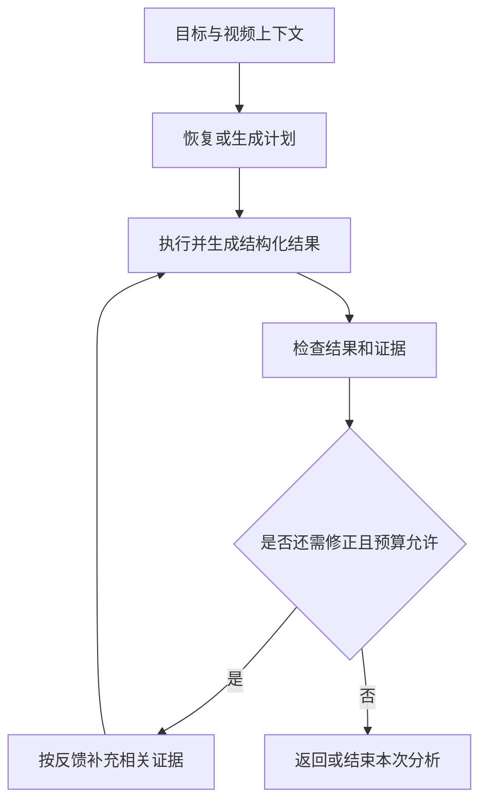

# 06 计划执行检查怎样组成 Agent

假设用户说：“帮我复习这节二叉树课程。”模型可以直接生成一段回答，但后端还希望结果覆盖目标、有视频证据、结构完整，并且在时间和费用允许时修正问题。这就是本项目设计闭环的原因。

## 三个角色代表三种职责

| 角色 | 通俗理解 | 需要关注的内容 |
| --- | --- | --- |
| Planner | 先列出要完成的事情 | 用户目标、任务拆解、分析范围 |
| Executor | 按计划完成分析 | 视频证据、结构化结论、建议 |
| Critic | 检查哪里还不够 | 目标覆盖、结构与证据等问题 |

这些角色通过代码和不同职责的模型调用组织起来，不要求部署三个服务，也不意味着它们是三个人。真正决定何时调用、保存什么、是否继续的，是后端编排代码。

## 一轮分析如何进行

例如计划要求讲清“概念、遍历顺序、常见错误”，执行结果却只解释概念，检查阶段就可能指出覆盖不足。后端依据反馈定向补充证据并尝试修正，而不是无目的地重复完整请求。

图中是简化流程。具体成功、失败和预算耗尽如何返回，必须结合 `AgentLoopService` 的分支阅读。

## 结构化输出为什么重要

后端需要把结果展示到页面、校验字段并保存检查点，所以不能只接受任意格式的长文章。模型输出需要解析和验证；缺字段、结构不合要求或证据越界时，后端要有明确处理。

`AgentLoopService` 中的 `validatePlan`、`validateResult`、`enforceEvidenceBounds` 和 `enforceStructureBounds` 说明：检查并不全部交给模型，代码也承担确定性的约束。

时间戳在范围内只能说明引用位置没有越界，不能单独证明文字结论一定正确。阅读时要区分结构校验、范围校验和内容质量。

## 分析模式和终止条件

用户可以指定模式，也可以由 `ModeRouter` 根据目标判断。项目支持通用、学习、审查和创作模式，路由失败时可以回退到通用模式，增强能力不应阻断主流程。

循环还需要停止条件。轮次、总时长、估算 Token 和费用预算共同限制任务，防止不断检查与修改。预算耗尽是系统边界，不代表结果已经通过检查；应看相应状态处理。

## 推荐读法

打开 [AgentLoopService](../../../server/src/main/java/com/example/server/service/AgentLoopService.java)，先找 `runWithinBudget`，再依次追踪 `resolvePlan`、`executeRound`、`critiqueRound` 和 `contextForRetry`。最后查看 `DeepSeekUtils` 中实际发给模型的输入。

用一张纸记录每个步骤“拿到什么、产出什么、失败怎么办”。自测：如果 Critic 永远说需要补充，究竟是哪段后端逻辑阻止无限循环？找到代码后再回答。

下一篇：[检索与记忆](07-retrieval-and-memory.md)。
